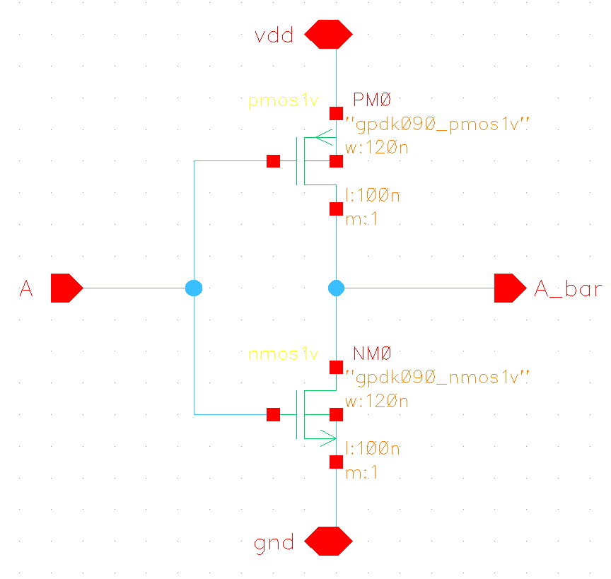

# PTL-Based 4×4 Wallace Tree Multiplier (Cadence Virtuoso)

A 4×4 Reduced Complexity Wallace Tree Multiplier (RCWTM) built bottom-up at transistor level, using a proposed **18-transistor pass-transistor-logic (PTL) full adder**. Designed and simulated in Cadence Virtuoso with the **GPDK090 (90nm)** PDK.


## Highlights

- Full adder transistor count: **56** (prior work [8]) → **38** (Boolean-direct, this work) → **18** (proposed PTL), a 52.6% reduction over the 38-transistor version
- Proposed adder at 90nm: ~48 ps delay, ~0.69 mW power, PDP ~33.1
- Multiplier built from 312 transistors, with identical full-adder cells across the reduction tree
- Functionally verified at 90nm; DRC and LVS clean on cell-level layouts

## Design hierarchy

Each block was designed, simulated and verified before being used in the next level.

`NOT → NAND → AND → XOR → 2:1 MUX (CMOS) → conventional full adder → PTL 2:1 MUX → proposed full adder → 4×4 RCWTM`

| Block | Schematic |
|-------|-----------|
| NOT |  |
| NAND |  |
| AND (NAND + NOT) |  |
| XOR (pass-gate style) |  |
| 2:1 MUX (Boolean-direct CMOS) |  |
| Conventional full adder (38 T) |  |
| PTL 2:1 MUX |  |
| Proposed PTL full adder (18 T) |  |

## Proposed full adder

```
SUM   = (B ⊕ C)' · A + (B ⊕ C) · A'
CARRY = (B ⊕ C)' · B + (B ⊕ C) · A
```

When B = C: SUM = A and CARRY = B. When B ≠ C: SUM = A' and CARRY = C. The select signal comes from B ⊕ C, and pass-transistor multiplexers implement the selection.

## Multiplier architecture

The Reduced Complexity Wallace algorithm keeps the same number of reduction stages as a conventional Wallace tree while using identical adder cells throughout, which simplifies routing.


## Verification (90nm, GPDK090)

- **Full adder:** all 8 input combinations of (A, B, Cin) checked
- **Multiplier:** Y = 1111 fixed, X swept from 0001 to 1111 (15 vectors), including 15 × 15 = 225 → `11100001`. This is a directed sweep, not an exhaustive test of all 256 input pairs.

| Input sweep | Output product |
|-------------|----------------|
|  |  |

## Results

### Full adder comparison (90nm)

| Parameter | Prior work [8] | Conventional (this work) | Proposed PTL |
|-----------|----------------|--------------------------|--------------|
| Transistors | 56 | 38 | 18 |
| Logic style | CMOS | XOR + MUX, Boolean-direct | Pass-transistor logic |
| Delay (ps) | 60.58 | ~52 | ~48 |
| Power (mW) | 2.283 | ~1.60 | ~0.69 |
| PDP | 138.28 | ~83.2 | ~33.1 |

Prior-work figures are as reported in [8] and were not re-simulated under the same conditions.

### Cross-technology comparison (RCWTM)

> **Note:** Only the **90nm** results were simulated (GPDK090). The **45nm** and **180nm** columns are **estimates** derived from the 90nm results. Method: **[ADD YOUR ESTIMATION METHOD HERE]**. Treat them as projections, not measured results.

| Parameter | 45nm (est.) | 90nm (simulated) | 180nm (est.) |
|-----------|-------------|------------------|--------------|
| Supply voltage (V) | 1.0 | 1.0 | 1.8 |
| Transistors | 312 | 312 | 312 |
| Dynamic power (mW) | ~0.21 | ~0.59 | ~1.47 |
| Leakage power (mW) | ~0.11 | ~0.10 | ~0.01 |
| Total power (mW) | ~0.32 | ~0.69 | ~1.48 |
| Delay (ps) | ~25 | ~48 | ~105 |
| PDP | ~8.0 | ~33.1 | ~155.4 |

## Physical design

DRC and LVS were run with the Cadence Virtuoso Layout Suite and GPDK090 rules. All three cells returned clean results with no violations.

| NAND | AND | PTL 2:1 MUX |
|------|-----|-------------|
|  |  |  |

## Limitations

- Only 90nm was simulated; 45nm and 180nm values are estimates
- Layout sign-off covers cell-level blocks only; the full multiplier layout is not done
- No post-layout (parasitic-extracted) simulation yet
- Multiplier verification uses a directed sweep (Y = 1111), not all input pairs

## Future work

- Extension to an 8×8 Wallace Tree Multiplier

## Tools

Cadence Virtuoso (schematic, ADE simulation, layout, DRC/LVS), GPDK090 PDK

## Team

Parv Patidar, Shrawan Kumar Bhagat, Sohel Pratap Singh, with mentor Dr. Shashi Tiwari, Dept. of ECE, IIIT Naya Raipur.

## Reference

[8] K. B. Jaiswal, N. Kumar, P. Seshadri, G. Laxminarayan, "Low Power Wallace Tree Multiplier using Modified Full Adder," ICSCN, 2015.

> This repository contains only the author's own schematics, waveforms, layout screenshots and results. No PDK files are included.
